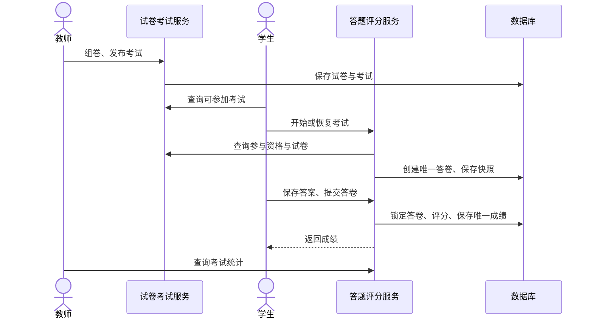

# 任务2、3实现与使用

本轮沿用任务1登录和题库接口，保留已有数据和公共响应格式。无Git元数据，不执行提交或推送。

## 任务2

- 草稿试卷创建、改名、选题、设置分值、移除题目、总分计算、发布、归档。
- 未发布考试可编辑名称、试卷与起止时间；发布后锁定配置，未开始可撤回。
- 管理列表显示试卷ID和考试ID。学生可查看可参加考试列表并直接进入。
- sql/schema-all.sql汇总当前全部建表语句，仅创建缺失表，不清空或迁移旧表；旧库不应借此重置。

## 任务3

- 开始/恢复答卷、版本控制保存、清空答案、提交确认、后台超时交卷。
- 单选、多选、判断完全匹配得分，BigDecimal保留两位小数。
- 重复交卷返回相同成绩，已交卷不能改答案，学生只能访问本人答卷。
- 学生个人成绩分页；教师按考试统计人数、均分、最高最低分、及格率和分数段。
- 超时提交网络失败后可再次尝试。考试页样式限制在组件内，避免影响题库、登录及用户管理。

## 本轮参与规则（实现决定，待全组确认）

课程范围不设置班级报名：所有未删除、启用且当前数据库角色为STUDENT的账号均有考试参与资格，再由考试发布状态和起止时间限制进入。替代仅允许100、101两个演示学生的旧逻辑。未提供班级或报名功能。

## 使用顺序

教师维护题库，创建试卷加入题目并发布；创建考试，设置有效时间并发布。学生在“考试中心/可参加考试”选择“进入考试”，答题后交卷，在“我的成绩”查看结果。教师在“教师统计”选择对应考试ID查询。

验证结果以本轮测试记录为准。Docker及本机部署不代表互联网生产可用性，不增加主观题或监考功能。
